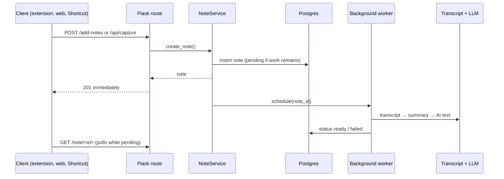

# Clipnote Architecture

Clipnote saves timestamped notes on YouTube videos, organises them, writes AI notes and
summaries, and lets you chat with a video. Notes can be captured from the Chrome extension,
the web app, or the iPhone share sheet.

## Clean architecture

Dependencies point inward only: `interfaces → application → domain`, and `infrastructure`
implements the ports that `application` defines.

```
server/
├── app.py                         entrypoint: load settings, create_app()
├── clipnote/
│   ├── constants.py               every named constant (stdlib-only, importable by any layer)
│   ├── domain/                    entities, errors, YouTube URL and clock parsing (stdlib only)
│   ├── application/
│   │   ├── ports.py               Protocols: repositories, LLM, transcripts, hashing, tokens...
│   │   ├── prompts.py
│   │   ├── services/              use cases: auth, notes, capture, labels, api tokens,
│   │   │                          export, enrichment, transcripts, videos
│   │   └── clipchat/              question answering: retrieval engine + service
│   ├── infrastructure/            adapters implementing the ports
│   │   ├── config.py              Settings from the environment
│   │   ├── db/                    Postgres repositories + SQL migrations + runner
│   │   ├── storage/               S3 and filesystem transcript caches
│   │   ├── transcripts/           youtube-transcript-api, Apify
│   │   ├── llm/                   OpenAI, offline stub
│   │   ├── youtube/               oEmbed titles
│   │   ├── security/              password hashing, JWT
│   │   └── jobs/                  thread-pool task runner
│   └── interfaces/http/           Flask app factory, blueprints, auth guards,
│                                  request schemas (pydantic), error mapping,
│                                  and container.py, the composition root
├── static/  templates/            front end (vanilla JS + Jinja)
└── tests/  unit/ api/ integration/ support/
```

Rules that keep it clean:

- `domain` imports nothing outside the standard library.
- Named constants live in `clipnote/constants.py`, never next to the code that uses them.
- Services depend on **ports** (`typing.Protocol`), never on Flask, psycopg, boto3 or OpenAI.
- Only `interfaces/http/container.py` knows which adapter backs which port.
- Routes validate input, call one service method and serialise the result. No SQL, no
  business rules.

## Data model (Postgres)

`users`, `video` (shared), `notes`, `label`, `video_label`, `user_video` (per-user
favourites), `api_tokens` (hashed), `schema_migrations`. Notes store `timestamp_seconds`
(nullable, for video-level notes), `note_type`, `status` and a mirrored legacy
`video_timestamp` string.

Migrations are plain SQL in `infrastructure/db/migrations/` and run **only** when you run
`python -m clipnote.infrastructure.db.migrate`, never on app start.

## Saving a note



Saving never waits for a transcript or an LLM. A note with the user's own text is always
`ready`, even if enrichment fails. Notes still `pending` after a restart are re-queued at
startup.

## Transcripts

`TranscriptService` checks the cache (S3 or disk), then tries each provider in order
(`TRANSCRIPT_PROVIDERS`, default `youtube_transcript_api,apify`), then caches the result.

## Deployment

- Backend: any container host (Render today). `Dockerfile` runs `python3 app.py`.
- Chrome extension: loaded unpacked from `extension/`.
- Local development: `docker compose up -d db`, see the README.
